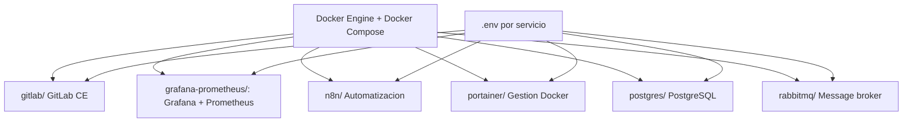

# COL — Stack de infraestructura con Docker Compose

Colección de servicios listos para desplegar con Docker Compose, cada uno en su propio directorio con `docker-compose.yml` y `.env.example`. Ideal para entornos de desarrollo, laboratorios y homelabs.

[](LICENSE)
[](https://docs.docker.com/compose/)
[](https://yaml.org/)
[](https://github.com/bi0punk/docker-compose-collection/actions/workflows/ci.yml)

## Contenido

- [Características](#características)
- [Arquitectura](#arquitectura)
- [Stack](#stack)
- [Estructura del repositorio](#estructura-del-repositorio)
- [Servicios incluidos](#servicios-incluidos)
- [Requisitos](#requisitos)
- [Instalación](#instalación)
- [Uso](#uso)
- [Configuración](#configuración)
- [Tests / CI](#tests--ci)
- [Roadmap](#roadmap)
- [Licencia](#licencia)

## Características

- Plug-and-play: cada servicio se levanta con un solo comando.
- Configuración sensible: cada `.env.example` documentada para reemplazar.
- Versiones pinned: imágenes con tag fijo para evitar breaking changes.
- Redes: preparados para integrarse en una misma red Docker externa.
- Secreto generable con `openssl` (ver Configuración).

## Arquitectura



Cada directorio es un stack independiente con su propio compose y variables de entorno.

## Stack

| Componente | Tecnología |
|---|---|
| Contenedores | Docker Compose (V2) |
| Servicios | GitLab CE, Grafana, Prometheus, n8n, Portainer, PostgreSQL, RabbitMQ |
| SO base | Imágenes oficiales (varias Alpine) |
| Config | Variables de entorno (`.env`) |

## Estructura del repositorio

```
docker-compose-collection/
├── gitlab/                 # GitLab CE
├── grafana-prometheus/     # Prometheus + Grafana (métricas)
├── n8n/                    # Automatización de flujos
├── portainer/              # Gestión Docker (UI)
├── postgres/               # Base de datos PostgreSQL
├── rabbitmq/               # Message broker
├── tests/
│   └── test_smoke.py
├── .env.example
├── .github/workflows/ci.yml
├── pyproject.toml
└── README.md
```

## Servicios incluidos

| Directorio | Servicio | Imagen (default pinned) | Puerto(s) |
|---|---|---|---|
| `gitlab/` | GitLab CE (git + CI/CD) | `gitlab/gitlab-ce:17.11.1-ce.0` | 8080, 8443, 8022 |
| `grafana-prometheus/` | Monitoreo (métricas) | `prom/prometheus:v3.4.0`, `grafana/grafana:12.0.1` | 3000, 9090 |
| `n8n/` | Automatización de flujos | `n8nio/n8n:1.93.0` | 5678 |
| `portainer/` | Gestión de Docker (UI) | `portainer/portainer-ce:2.27.4` | 9000, 9443 |
| `postgres/` | Base de datos PostgreSQL | `postgres:16-alpine` | 5432 |
| `rabbitmq/` | Message broker | `rabbitmq:4-management-alpine` | 5672, 15672 |

## Requisitos

- Docker Engine >= 24.0
- Docker Compose >= 2.20 (plugin `docker compose`)
- Sistema Linux / macOS / Windows (WSL2)
- Puertos disponibles (ver tabla de servicios)

## Instalación

```bash
git clone https://github.com/bi0punk/docker-compose-collection.git
cd docker-compose-collection
```

## Uso

```bash
# 1. Entra al directorio del servicio que quieres levantar
cd postgres

# 2. Copia el archivo de variables y edítalo
cp .env.example .env
nano .env

# 3. Levanta el servicio
docker compose up -d

# 4. Verifica el estado
docker compose ps
docker compose logs -f
```

## Configuración

Cada servicio tiene su propio `.env.example` con variables documentadas. Variables comunes:

| Variable | Descripción |
|---|---|
| `POSTGRES_PASSWORD` | Contraseña de base de datos |
| `GITLAB_ROOT_PASSWORD` | Contraseña root de GitLab |
| `GRAFANA_SECRET_KEY` | Clave de cifrado de Grafana |
| `N8N_ENCRYPTION_KEY` | Clave de cifrado de n8n |
| `RABBITMQ_ERLANG_COOKIE` | Cookie Erlang para RabbitMQ |

Generar secretos rápidamente:

```bash
# Contraseña aleatoria (16 bytes, base64)
openssl rand -base64 16

# Clave hex (32 bytes)
openssl rand -hex 32
```

Antes de producción: reemplaza todos los valores marcados, revisa versiones pinned, coloca los servicios en la misma red externa si deben comunicarse, expón solo los puertos necesarios y planifica backups de los volúmenes.

## Tests / CI

```bash
pip install pytest
pytest tests/ -v
```

GitHub Actions ejecuta lint (Ruff) y tests (pytest) en cada push/PR.

## Roadmap

- [x] Servicios básicos de infraestructura
- [ ] HTTPS automático con Traefik/Caddy
- [ ] Script de deploy completo para todo el stack
- [ ] Monitoreo centralizado con logs agregados
- [ ] Respaldo automatizado de volúmenes
- [ ] Stacks adicionales (Redis, MongoDB, Elasticsearch)

## Licencia

MIT — ver [LICENSE](LICENSE).